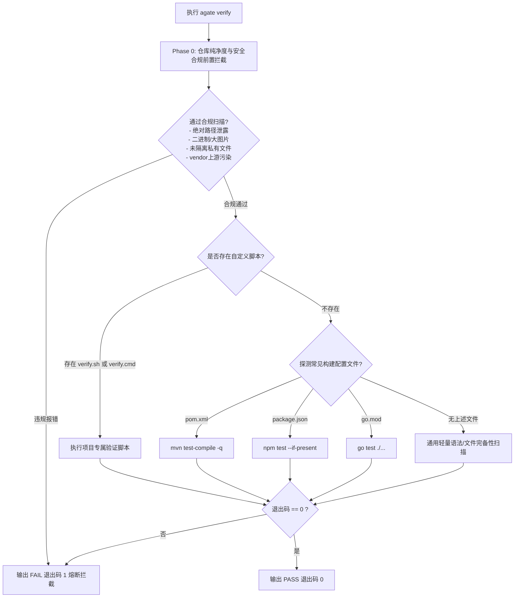

# Agate (Agent Gate) 系统架构与技术设计文档

## 一、 核心问题与设计考量

### 1.1 现实痛点
在实际混合使用 Cursor、Antigravity、Claude Code 等 AI 工具时，主要有三个工程痛点：

- **工具生态分裂**：每款工具各认各的规则路径（`.cursorrules`、`GEMINI.md`、`CLAUDE.md`）。换个环境就得重新教一遍，久而久之各处规则严重漂移。
- **团队代码库被污染**：AI 生成的会话缓存、任务清单（`TASK.md`）和临时文件经常被误提交。直接改团队公共 `.gitignore` 又会把个人偏好强加给同事。
- **代码变动缺乏闭环证据**：AI 经常未经方案确认就大幅覆写代码，改坏后又盲目乱试，甚至提交编译不通过的半成品。

### 1.2 核心防线
针对这些问题，`agate` 确立了三条务实的工程防线：

1. **规约单一事实源**：全局只维护一份核心规范，由工具自动分发到各个编辑器的对应目录，杜绝规则多头维护；
2. **本地隐形隔离**：利用 Git 原生的本地私有机制（`.git/info/exclude`）静默隐藏 AI 专有文件，对团队公共提交树完全透明；
3. **两阶段门禁与自检闭环**：代码改动前必须输出方案等待确认；改动后必须在终端执行自检并拿到绿色的通过物证；同一错误连续两次未过强制熔断交还主控权。


---

## 二、 架构总览与核心分层

```
+-------------------------------------------------------------------------------+
|                             AI Agent 交互层 (LLM Context)                      |
|  - 两阶段硬门禁 (Two-Phase Gate)          - 3-Hop 寻路协议 (MAP -> Context)    |
|  - 中文原生 & 代码完整性保证               - 两振硬熔断机制 (Two-Strike Failsafe)|
+---------------------------------------+---------------------------------------+
                                        | 规则分发 & 约束对齐
+---------------------------------------v---------------------------------------+
|                      agate 核心分发与适配引擎 (CLI Engine)                    |
|  - 模板自包含引擎 (go:embed)               - 跨平台软链/拷贝自适应 (Symlink Fallback)|
|  - 索引防爆仓生成 (.ignore)               - 目标环境探测与受管分发计划 (Adapter/Plan)|
+---------------------------------------+---------------------------------------+
                                        | 挂载与拦截
+---------------------------------------v---------------------------------------+
|                            本地 Git & 物理文件系统层                          |
|  - 私有跟踪隔离 (.git/info/exclude)        - 提交硬门禁 (.git/custom-hooks)        |
|  - 闭环验证执行器 (agate verify)           - 架构地图资产 (MAP.md / contexts)       |
+-------------------------------------------------------------------------------+
```

### 2.1 Agent 交互层
约束 AI 行为的规则引擎，无论用户接入何种 IDE 或模型，均统一注入以下基线：
- **A 级只读诊断**：遇疑问句、报错信息或模糊需求，强制只读分析，严禁调用写操作工具；
- **C 级实施确认**：实施前必须输出精简 Plan，等待用户显式回复“执行”；
- **交付闭环**：修改后自动调起自检命令，获取 `[PASS]` 退出码与物证方可交付。

### 2.2 CLI 核心引擎
采用 Go 编写的单二进制可执行文件：
- **`pkg/adapter`**：统一规约分发器与只读计划引擎（`adapter.go` / `plan.go`），将内嵌或全局规约按三大渲染范式（`markdown` 受管区块、`frontmatter-md` 保留或生成 YAML 头部的 `.mdc`、`pointer` 轻量寻路指针并内嵌规则哈希摘要）合并至 `AGENTS.md`、`.gemini/GEMINI.md`、`.cursorrules`、`CLAUDE.md`、`.windsurfrules` 及开放式自定义入口，支持双重快照复核、跨工具受管标记拦截、Git 跟踪保护（含大小写不敏感 `os.SameFile` 校验）与双向重叠读取诊断；
- **`pkg/git`**：Git 仓库探查器，管理 `.git/info/exclude` 受管块、Git Worktree 寻径、空仓库（Unborn HEAD）分支回退与本地 Hook 生命周期；
- **`pkg/guard`**：Phase 0 静态合规与安全审计引擎，执行敏感凭据、超大文件、断点残留、绝对路径等 7 大红线拦截，支持暂存区定向审查、违规代码行构造期自动脱敏、基于 `--directory` 的整目录忽略缓存查询，以及 `guard.large_file_mb`、`guard.todo`、`guard.absolute_path` 策略覆盖；
- **`pkg/relay`**：跨 Agent 与多角色（`dev`/`test`/`ops`）任务接力状态机中枢，管理双模 `TASK.md`（含 `snapshot_digest` 工作区代码快照摘要）、`.ai-memory/sessions/active-role.md` 会话角色卡、租约互斥锁（含同工具多窗口 `session_id` 隔离）与 `.transition` 过渡锁（含加锁、释放与陈旧锁原子重命名回收）及接力四要素；
- **`pkg/reporter`**：自包含单文件 HTML 审查报告引擎，汇聚已脱敏安全审计、Diff 对比、任务看板与物证日志（区分“未执行动态测试”与“动态测试未通过”），支持跨平台浏览器安全唤起；
- **`pkg/harness`**：地图骨架生成器、跨平台文件操作、相对路径自适应软链回退与真原子写入机制；
- **`internal/templates`**：通过 `go:embed` 将标准规约、地图骨架、任务模板与审查 HTML 模板固化进可执行二进制中，支持脱网离线运行；
- **`pkg/agent`**：多 Agent 环境感知（支持内置工具与自定义档案 `env_keys` 强指纹优先于 `term_programs` 弱指纹的两阶段探测）、开放式工具档案校验（`profile.go`）及注册中心；
- **`pkg/config`**：三层策略配置中心（个人全局 `~/.agate/config.toml` + 团队项目 `.agate/config.toml` + 本机私有 `.agate/config.local.toml`），支持工具档案持久化（`UpsertProfile`）与本机安全门禁单调收紧（Monotonic Tightening）；
- **`pkg/workspace`**：多工具窗口级独立视图引擎（`workspace.go`），在 `.ai-memory/workspaces/<target>.code-workspace` 生成独立文件树与搜索过滤视图，零侵入团队 `.vscode/settings.json`。

### 2.3 底层 Git 与执行层
- **隐形隔离机制**：利用 Git 内置的 `.git/info/exclude` 本地私有忽略文件，采用受管标记块（Managed Block）增量原子注入，避免修改团队共用的 `.gitignore`；
- **双重物理 Hook 路径**：通过 `git config --local core.hooksPath .git/custom-hooks` 同时挂载私有 `pre-commit`（暂存区定向自检）与 `pre-push`（物理阻断 AI/脚本自动化偷跑推流，锁定提交权 100% 归人类），不破坏用户全局或其他三方 Hook。

---

## 三、 详细模块设计

### 3.1 目录结构规划
```
agate/
├── cmd/
│   ├── root.go             # 根命令定义、三态退出码契约、版本信息与全局 Flag
│   ├── init.go             # agate init 规则计划预览与护栏编排逻辑 (--dry-run, --allow-tracked)
│   ├── profile.go          # agate profile 开放式工具档案列表与注册 (list/add)
│   ├── workspace.go        # agate workspace 多工具独立窗口视图管理 (plan/apply/restore/open)
│   ├── verify.go           # agate verify 自检引擎 (--staged, --strict, --skip-guard, --report, --resume-after-break)
│   ├── ci.go               # agate ci verify 远程 CI/CD 严格门禁与报告入口
│   ├── export.go           # agate export 自包含 HTML 审查报告导出
│   ├── view.go             # agate view 快速浏览器预览审查报告
│   ├── task.go             # agate task 跨 Agent 与多角色任务接力 (status/claim/handover/resume/done)
│   ├── isolate.go          # agate isolate 隐形隔离逻辑
│   ├── scan.go             # agate scan 拓扑扫描与确定性回填
│   └── hook.go             # agate hook install / uninstall / status
├── pkg/
│   ├── adapter/
│   │   ├── adapter.go      # 多 Agent 目标解析、优先级决策与规约源加载
│   │   └── plan.go         # 只读分发计划、三大渲染范式合并、快照复核、跟踪保护与双向重叠诊断
│   ├── agent/
│   │   ├── registry.go     # 支持自定义档案的两阶段智能体环境指纹嗅探与类型注册中心
│   │   └── profile.go      # 内置与开放式工具档案、三大格式范式、跨平台路径边界与碰撞校验
│   ├── config/
│   │   └── config.go       # 全局/项目/本机三层配置合并、UpsertProfile 与安全单调收紧
│   ├── workspace/
│   │   └── workspace.go    # .code-workspace 独立窗口视图计划、原子生成、恢复与受控启动
│   ├── git/
│   │   ├── exclude.go      # .git/info/exclude 受管块管理、去重与根目录寻径
│   │   ├── hook.go         # Git Hooks 安装、激活、卸载、状态查询与防偷跑
│   │   └── diff.go         # 原生 Git Diff 提取、分支元数据读取（兼容空仓库）
│   ├── guard/
│   │   └── preflight.go    # Phase 0 静态安全红线、违规行自动脱敏与暂存区定向审计
│   ├── relay/
│   │   ├── manifest.go     # TASK.md Frontmatter 双模解析（含多角色与代码快照摘要）
│   │   ├── lock.go         # .ai-memory/locks/task.lock 租约锁（含 SessionId 隔离）与 .transition 守护锁
│   │   └── relay.go        # 认领、会话角色卡、自检交接、指定接棒人与角色核验及终态归档编排
│   ├── reporter/
│   │   ├── report.go       # 数据汇聚、HTML 模板编译落盘与历史查找
│   │   └── browser.go      # 跨平台系统浏览器安全拉起实现 (rundll32 / open / xdg-open)
│   └── harness/
│       ├── fs.go           # 跨平台软链、拷贝降级与崩溃安全原子写 (WriteFileAtomic)
│       └── scaffold.go     # MAP.md / contexts / TASK / MEMORY 骨架初始化
├── internal/
│   └── templates/
│       ├── embed.go        # go:embed 静态资源声明
│       ├── review.html.tpl # 自包含 HTML 审查报告模板 (零 CDN 外链依赖)
│       ├── task.tpl        # YAML Frontmatter + 接力四要素任务看板模板
│       ├── SKILL.md        # 核心 AI 协同规约 (SSOT)
│       ├── ignore.tpl      # .ignore 索引防爆仓模板
│       ├── agents.tpl      # MAP.md 初始骨架模板
│       ├── context.tpl     # contexts/context.md 技术契约模板
│       └── memory.tpl      # MEMORY.md 长期记忆模板
├── vendor/                 # 离线打包依赖
├── go.mod
├── go.sum
└── main.go
```

### 3.2 三层策略配置与开放式 Agent 分发策略

配置采用“个人全局（`~/.agate/config.toml`）$\rightarrow$ 团队项目（`.agate/config.toml`）$\rightarrow$ 本机私有（`.agate/config.local.toml`）”三层合并架构，本机私有配置对安全门禁（`guard.strict`、`hooks.install`、`guard.todo`、`guard.absolute_path`）强制执行**单调收紧（只升不降）**。初始化目标采用确定性优先级：显式 `-t` 参数优先，其次读取配置中的 `agent.targets`，再通过两阶段指纹（含自定义档案的 `env_keys` 与 `term_programs`）识别当前 Agent 环境，最后探测项目已有规则入口；当上述线索均无法确定目标时，返回明确错误要求显式传入 `--targets`，绝不盲目猜测默认工具。

规则分发采用 `BuildPlan`（只读预览）与 `Plan.Apply`（排他锁 + 双重快照复核 + 原子落盘）分离架构，支持 `markdown`（标准受管区块）、`frontmatter-md`（保留或注入 YAML Frontmatter 的 `.mdc` 规则）与 `pointer`（轻量寻路指针并内嵌 SHA-256 摘要）三大渲染范式，保留区块外用户自定义内容；对 Git 已跟踪文件（含大小写不敏感文件系统下的同名物理文件）默认阻断，须由用户显式传入 `--allow-tracked` 方可合并。

### 3.3 CI 远程门禁

`.github/workflows/agate.yml` 在 Pull Request 和 `main` 推送事件中执行 `agate ci verify`；GitLab 可使用 `.gitlab-ci.yml`。该入口固定启用严格验证和 HTML 报告。本地 `pre-commit` / `pre-push` 属于开发体验层，远程 CI 才是最终合并裁决层；即使本地使用 `--no-verify` 绕过 Hook，Required status check 仍会阻止未通过的 Pull Request 合并。

### 3.4 可选 Jev 语义决策适配层（规划）

Agate 的核心职责是可复现的确定性门禁：扫描、测试、Hook 与 CI 的结果直接形成允许或阻断。Jev Skills 适合承担另一类问题：当证据完整但结论无法用简单规则描述时，对候选恢复路径、任务交接完整度、Agent 接手建议和审查优先级给出结构化判断。

```text
确定性事实（Guard / Test / Hook / CI）
                ↓
可选 Jev 语义建议（choice / score / needs_review）
                ↓
当前 Agent 或人类确认下一步
```

该适配层必须保持可插拔和默认关闭，避免破坏 Agate 的单二进制、离线可用与零外部运行时依赖特征。Jev 的选择结果不等价于授权：不能放行安全问题、绕过测试、解除 Git Hook，也不能触发提交、推送或合并。API 调用前需用户明确同意，输入必须脱敏并最小化；无法判断、`needs_review` 或 API 失败时只能转人工，不得静默模拟或放行。

### 3.5 跨平台软链与优雅降级算法
在 Windows 环境下，普通用户通常没有 `SeCreateSymbolicLinkPrivilege` 权限。若盲目调用 `os.Symlink` 会抛出 `A required privilege is not held by the client` 错误。

`agate` 采用如下两段式容错机制（非 Windows 下对相对路径自动计算相对于目标父目录的路径后再创建软链）：
```go
func LinkOrCopy(src, dst string) error {
    // 1. 尝试符号链接 (Linux / macOS / 开启开发者模式的 Windows)
    err := os.Symlink(linkTarget, dst)
    if err == nil {
        return nil
    }

    // 2. 捕获权限不足或 Windows 特殊错误，平滑降级为物理文件拷贝
    if runtime.GOOS == "windows" || isPrivilegeError(err) {
        return copyFile(src, dst)
    }

    return err
}
```

### 3.6 验证调度状态机 (`agate verify`)
`agate verify` 为 Agent 提供确定性的交付验收门禁，其执行遵循严格的两阶段防御：



### 3.7 关键工程优化与安全设计

#### 1. 崩溃安全原子写入 (`pkg/harness/fs.go:WriteFileAtomic`)
规约分发或模板更新时，直接调用 `os.WriteFile` 在遇到断电或强杀时容易造成半截文件损坏。Agate 采用标准的崩溃安全原子模式：
- 在目标文件同卷目录下创建临时文件；
- 将内容完全写入后调用 `file.Sync()` 强制将数据刷入物理磁盘介质；
- 调用操作系统原生原子重命名（`os.Rename`）瞬间替换目标文件，确保任何意外场景下原文件完整无损。

#### 2. 大仓库批量内存忽略优化与防父目录污染 (`pkg/guard/preflight.go:newGitContext`)
在包含数万未跟踪文件的大型仓库中，对每个文件调用一次 `git check-ignore` 子进程会产生秒级甚至十秒级的进程创建开销。
Agate 在初始化扫描上下文时，批量执行 `git -c core.quotepath=false ls-files --others -i --exclude-standard`（缓存被忽略文件）及 `--directory`（仅将以 `/` 结尾的整目录忽略项写入 `ignoredDirs`），既将常规忽略检测系统调用降为 0，又防止目录内单个被忽略普通文件污染父目录导致新创建的未跟踪违规文件漏检。

#### 3. 暂存区精准审查 (`agate verify --staged`)
解决工作区脏代码与实际准备提交内容脱节的痛点：
- 调用 `git diff --cached --name-only --diff-filter=ACMR` 定向获取暂存文件列表；
- 优先通过 `git show :<path>` 直接读取 Git Index 中的暂存内容，而非工作区物理文件；
- 仅当暂存区内容触发安全红线时阻断，未暂存的本地探索性脏代码互不干扰。

### 3.8 跨 Agent 任务接力与状态机设计 (Agate Relay)
为了支持开发者在多款 AI 编程助手（Codex、Cursor、Antigravity、Claude Code、Windsurf）之间丝滑接力，Agate 引入了轻量级离线任务中枢：

1. **状态机全生命周期驱动**：
   ```
   [TODO / 空闲]
         │  agate task claim
         ▼
     [CLAIMED]
         │  代码编辑中
         ▼
   [IN_PROGRESS]
         │  agate task handover (强制通过 Phase 0 + 动态测试门禁并产出 HTML 物证)
         ▼
   [HANDOVER_READY] ──── agate task resume (核验 next_agent) ────► [IN_PROGRESS] (新 Agent 接棒)
         │
         │  agate task done (最终交付，执行全量门禁并解绑互斥锁)
         ▼
      [DONE] (终态归档)
   ```
2. **多 Agent / 多会话租约互斥锁 (`pkg/relay/lock.go`)**：
   - 采用 `.ai-memory/locks/task.lock` 软互斥保护，配对 `.task.lock.transition` 内核排他过渡锁（覆盖 `AcquireLock`、`ReleaseLock` 及过期过渡锁原子重命名回收），记录持有者 Agent、角色（`role`）、会话标识（`session_id`）与到期时间；
   - 默认 2 小时租约，超时自动释放，杜绝 Agent 异常退出导致的死锁；支持同工具多窗口会话隔离与 `--force` 应急强制抢占。
3. **多角色协同、会话角色卡与代码快照绑定 (`pkg/relay/relay.go`)**：
   - 支持 `--role dev|test|ops` 与 `--next-role` 角色流转，在 `.ai-memory/sessions/active-role.md` 生成当前会话专属角色边界卡（零侵入根目录共享 `AGENTS.md`/`.cursorrules`）；
   - `handover` 自动计算并绑定工作区代码快照摘要（`snapshot_digest`），`resume` 与 `done` 在 `test`/`ops` 角色下强制核验代码快照与审查物证一致性。
4. **不可篡改流转审计时间线 (Handover Timeline)**：
   - 每次交接在 `TASK.md` 正文末尾自动追加结构化表格行（自动转义备注中的 `|` 分隔符），记录交接时间、From/To、HTML 审查物证与批注；
   - 解析时采用通用非贪婪二级标题截断与 CRLF 归一化，彻底防御 Markdown 表格对“暗坑警示”四要素的污染。

### 3.9 自包含单文件 HTML 审查报告引擎 (Agate Reporter)
用于解决团队异步代码评审、自检物证核验与合规归档：
- **纯原生自包含**：HTML 模板内嵌样式与折叠脚本，零外部 CDN 网络依赖，脱网双击即看；
- **全量汇聚与脱敏**：聚合展示已脱敏的 Phase 0 7 大安全红线体检、Git 分支与暂存区/工作区 Diff 对比、当前任务状态机与自动化单测控制台日志；
- **跨平台安全弹出**：`pkg/reporter/browser.go` 原生支持 Windows (`rundll32 url.dll,FileProtocolHandler`，规避 `cmd.exe` 元字符注入)、macOS (`open`) 与 Linux (`xdg-open`) 浏览器秒级自动唤起并异步回收子进程句柄。

### 3.10 两振熔断机制 (Two-Strike Circuit Breaker) 物理实现
为了在物理层彻底杜绝 AI Agent 面对报错盲目猜测、反复死循环改动代码：
- `cmd/verify.go` 在 `.ai-memory/.verify_streak` 中原子维护连续自检失败计数；
- 只要有任意一次自检成功通过，计数器即刻原子重置为 0；
- 当检测到连续自检失败次数 `>= 2` 时，CLI 强行向终端输出醒目红色熔断警示框，提示 Agent 必须停手交还主控权；人类传入 `--resume-after-break` 后，唯有当次恢复自检真正通过才会清除熔断计数。

### 3.11 开放式工具扩展体系与多工具独立窗口视图 (`agate profile` & `agate workspace`)
针对 AI 编程工具生态无法静态穷举以及同仓多工具规则并存干扰两大架构挑战：
1. **三大规则范式抽象 (`pkg/agent/profile.go` & `pkg/adapter/plan.go`)**：
   - 将所有 AI 编程工具的规则文件归纳为三种通用范式：`markdown`（标准受管区块合并）、`frontmatter-md`（保留或生成顶部 YAML Frontmatter 的 `.mdc` 规则）与 `pointer`（轻量寻路指针引用并内嵌规则 SHA-256 摘要）；
   - 支持在自定义档案中声明 `env_keys`（强指纹）与 `term_programs`（弱指纹），通过 `DetectEnvironmentWithProfiles` 实现免 `-t` 自动环境识别。
2. **三层配置与安全单调收紧 (`pkg/config/config.go` & `cmd/profile.go`)**：
   - 支持 `~/.agate/config.toml`（个人全局工具库）+ `.agate/config.toml`（团队共享）+ `.agate/config.local.toml`（本机私有覆写）三层叠加；
   - 本机私有配置对安全门禁（`guard.strict`、`hooks.install`、`guard.todo`、`guard.absolute_path`）实行**单调收紧（Monotonic Tightening，只升不降）**，杜绝本机配置私自放宽团队安全红线。
3. **窗口级独立视图隔离 (`pkg/workspace/workspace.go` & `cmd/workspace.go`)**：
   - 通过 `agate workspace plan/apply/restore/open` 在 `.ai-memory/workspaces/<target>.code-workspace` 生成窗口独立的 `files.exclude` / `search.exclude` 视图文件，仅隐藏其他工具规则并保留当前工具规则与共享双地图，完全不触碰团队共享 `.vscode/settings.json`。

---

## 四、 跨平台与技术选型论证

### 4.1 为什么选择 Go 而非 Node.js (npx) / Python / Shell？

| 考量维度 | Go 单二进制方案 | Node.js (npx) 方案 | Shell 脚本方案 |
| :--- | :--- | :--- | :--- |
| **外部运行时依赖** | **零依赖**。开箱即用，无环境绑架 | 强依赖宿主机已安装 Node.js/npm | 依赖 Bash/PowerShell，语法差异大 |
| **Git Hook 启动耗时** | **< 10ms**，无感知极速拦截 | 200~800ms，每次提交明显卡顿 | 10~50ms，但在 Windows 上极不稳定 |
| **跨平台路径与权限** | 标准库原生抽象抹平 OS 差异 | 需要第三方 npm 模块拼接处理 | Windows 与 Linux 脚本逻辑完全分裂 |
| **分发与更新** | 单文件拷贝、Homebrew、Scoop | `npm install -g` 或 `npx` | 手动下载 `curl | bash`，维护繁琐 |
| **后端/运维无前端场景** | 100% 友好，纯 Java/Go/C++ 项目无负担 | 纯后端服务器需被迫额外安装 Node 运行时 | 勉强支持，但跨系统难以移植 |

结论：对于底层 Git 治理与轻量门禁工具，编译型单二进制（Go）在启动性能、通用性与系统侵入性上具有压倒性优势。

---

## 五、 后续演进路线图 (Roadmap)

### Phase 1: 核心基础（已完成落地）
- [x] CLI 根命令骨架与嵌入式模板（`go:embed`）；
- [x] 多 Agent 规则分发与软链降级拷贝；
- [x] `.git/info/exclude` 自动化去重注入与隔离；
- [x] `agate verify` 自检门禁与本地 `pre-commit` 拦截。

### Phase 2: 动态架构地图与多 Agent 接力（已完成落地）
- [x] `agate scan`：自动解析项目 `pom.xml`、`package.json`、`go.mod` 等，自动丰富 `MAP.md` 端口拓扑；
- [x] `agate task`：跨 Agent 与多角色（`dev`/`test`/`ops`）协同接力看板、同工具多窗口 `SessionId` 租约锁、独立会话角色卡与 `snapshot_digest` 代码快照一致性核验；
- [x] `agate export` & `agate view`：自包含 HTML 审查物证报告导出与极速预览；
- [x] 两振熔断机制（Two-Strike Circuit Breaker）：物理失败计数器与终端红框拦截；
- [x] `agate profile` & `agate workspace`：开放式工具档案扩展（三大规则范式、动态环境指纹嗅探、三层配置与安全单调收紧）及多工具 `.code-workspace` 窗口级独立视图隔离。

### Phase 3: CI/CD 接入与云端发布（部分完成）
- [x] GitHub Actions Goreleaser 跨平台全自动发版流水线；
- [x] 语义化版本自动化发布脚本（`./scripts/bump.sh`）；
- [x] Pull Request 与 `main` 推送的 Agate 严格验证及 HTML 报告 Artifact；
- [ ] 规则一致性校验（`agate check --strict`），防止本地规约被手动意外篡改。

### Phase 4: 可选语义决策辅助（规划）
- [ ] 定义 Jev 适配器接口与本地审查物证格式；
- [ ] 在 `agate task` 中提供交接完整度与接手建议，但不自动流转状态；
- [ ] 在 `agate verify` 中提供失败分流建议，但不改变 PASS/FAIL 结果；
- [ ] 建立脱敏、用户同意与 `needs_review` 人工升级机制。
