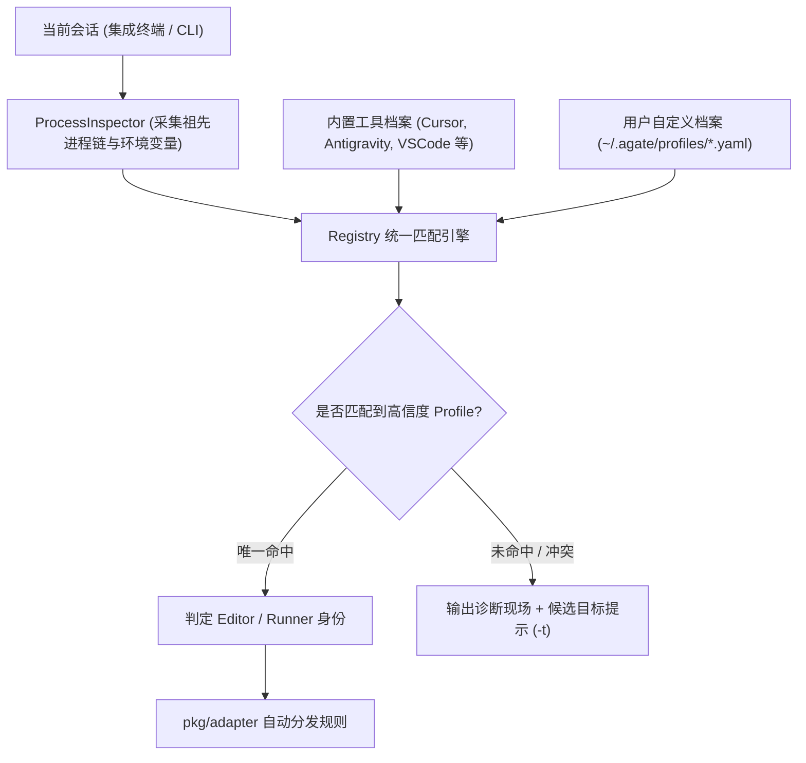
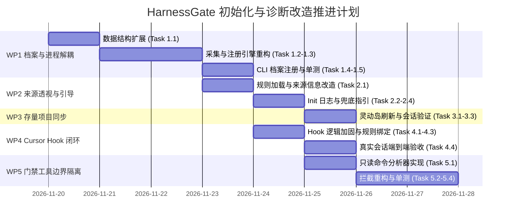

# HarnessGate 初始化与诊断流程实施方案

日期：2026-11-19  
状态：待实施  
项目：HarnessGate / Agate  
基线版本：Git Commit `fe78e72`，本机 PATH `agate v0.5.0`  
关联复盘报告：[docs/harnessgate-session-findings-2026-11-19.md](../../docs/harnessgate-session-findings-2026-11-19.md)  
关联历史方案：[docs/superpowers/plans/2026-11-13-windows-host-auto-detection.md](2026-11-13-windows-host-auto-detection.md)

---

## 1. 方案背景与目标

### 1.1 现状与已确认事实
在 2026-11-19 的复盘中，基于「灵动岛」初始化实测、Windows 进程采集分析以及 Cursor/Antigravity 实机表现，确认了以下关键事实与缺陷：
1. **全局规约覆盖内置模板**：`agate init` 优先读取用户家目录规则文件（如 `~/my_skills/SKILL.md`）。因早期个人规约未同步新版三层门禁与诊断状态机制，导致向新旧项目分发时覆盖了二进制内置的新模板，持续注入旧版规约。
2. **宿主识别存在断点且扩展受限**：Windows 祖先进程采集虽然具备基础能力，但本地进程匹配（如 `Cursor.exe`、`Code.exe`）硬编码在 `collector.go` 中，未覆盖 `Antigravity IDE.exe`；同时缺乏通过配置动态扩充宿主进程特征的机制，新 Agent 无法无缝接入。
3. **识别失败缺乏操作指引**：当环境证据不足或冲突时，缺少针对当前会话具体候选的明确提示，未引导用户使用 `agate init -t <目标>` 进行手动选择。
4. **提示词扩写交付缺少端到端闭环**：Cursor 原生 Hook 协议代码已实现，但真实客户端“提交请求 -> 自动扩写 -> 模型读取交付物证”的全链路在实际会话中缺少自动化物证归档。
5. **门禁工具边界粗糙**：当前的写入前工具门禁将 `Shell`、`Bash` 等一并纳入拦截，导致只读诊断阶段正常的排查命令被误锁，影响排查效率。

### 1.2 预期交付目标
本实施方案旨在彻底解决上述断点，实现以下工程目标：
- **目标 A（通用宿主接入）**：将进程匹配规则与规则映射统一沉淀至工具档案（`AgentProfile`），内置与外部工具共用同一匹配与仲裁逻辑，支持新 Agent 零代码编译动态接入。
- **目标 B（来源透视与智能兜底）**：`agate init` 显式呈现命中的规则物理路径、版本摘要与正文差异；识别未决时提供精确原因分析及一键可复制的 `-t` 兜底命令。
- **目标 C（存量项目平滑同步）**：刷新存量受管项目（如「灵动岛」），并在真实客户端验证新规约加载与只读免确认行为。
- **目标 D（扩写端到端交付）**：在 Cursor 真实交互中闭环原生 Hook 的编译产物生成与模型读取证据记录。
- **目标 E（门禁工具边界隔离）**：重构拦截分类，精确放行诊断阶段的只读探查，仅在物理修改发生前核验方案确认授权。

### 1.3 技术约束与原则
- 语言与编译：Go 1.21+，必须保持 `CGO_ENABLED=0`，严禁引入第三方外部依赖。
- 寻路原则：严格遵循 `MAP.md` -> `contexts/context.md` -> 目标源码的 3-Hop 寻路。
- 安全公理：遵循动作二分与外溢死锁公理，本地闭环动作由单测和 `agate verify` 闭环，外溢动作严格死锁。
- 容错机制：两振硬熔断（连续失败 2 次必须停步交出控制权）。

---

## 2. 架构设计与技术演进

### 2.1 工具档案架构扩展 (Profile-Driven Detection)
将硬编码的进程匹配解耦，由档案驱动检测与仲裁：



#### 数据结构升级 (`pkg/agent/profile.go`)
```go
// ProcessMatcher 定义宿主进程匹配条件
type ProcessMatcher struct {
    OS          string   `json:"os" yaml:"os"`                   // windows, linux, darwin
    ExactNames  []string `json:"exact_names" yaml:"exact_names"` // 例: ["Antigravity IDE.exe", "antigravity"]
    PathPatterns []string `json:"path_patterns" yaml:"path_patterns"`
}

// 扩展 AgentProfile 字段
type AgentProfile struct {
    // 既有字段保持兼容
    Name         string            `json:"name" yaml:"name"`
    DisplayName  string            `json:"display_name" yaml:"display_name"`
    RulesPath    string            `json:"rules_path" yaml:"rules_path"`
    RulesFormat  string            `json:"rules_format" yaml:"rules_format"`
    EnvMarkers   map[string]string `json:"env_markers" yaml:"env_markers"`
    TermProgram  string            `json:"term_program" yaml:"term_program"`
    
    // 新增匹配字段
    ProcessMatchers []ProcessMatcher  `json:"process_matchers" yaml:"process_matchers"`
    SupportedRoles  []AgentRole       `json:"supported_roles" yaml:"supported_roles"` // Editor, Runner, Both
    Priority        int               `json:"priority" yaml:"priority"`
}
```

### 2.2 规则来源决策与透视机制
在 `agate init` 执行期间建立透明的决策树，杜绝静默回退：
1. **显式优先级**：用户指定 `-t` > 项目配置 `agent.targets` > 自动环境探测 > 已存在入口文件。
2. **来源透视卡片**：输出所选规则的 `来源类型` (全局文件/内置模板)、`物理绝对路径`、`SHA-256 校验和` 以及与项目当前文件的 `Diff 概要`。
3. **差异警告**：若命中的全局规则文件缺少核心章节（如指令扩写解码、诊断状态要求），主动输出黄色警告并提示全局文件更新命令。

### 2.3 门禁工具分类与状态机 (Tool-Gating State Machine)
重构 `pkg/prompt/cursor_hook.go` 中的工具检查逻辑，分离只读与修改：

| 工具类型 | 典型工具 | 诊断阶段 (未完成确认) | 实施阶段 (已确认 Plan) | 判定依据 |
| :--- | :--- | :---: | :---: | :--- |
| **只读探查工具** | `ReadFile`, `ListDir`, `Grep`, 只读命令 (`git status`, `ls`, `cat`) | **直接放行** | **放行** | 无持久化副作用 |
| **可疑 Shell 命令** | 包含重定向、管道写入、`rm`, `touch`, `sed`, `git add` 等 | **强制拦截** | **放行** | 命令特征正则分析 |
| **写文件工具** | `WriteFile`, `EditFile`, `DeleteFile` | **强制拦截** | **放行** | 显式文件写入操作 |
| **外溢动作** | `git push`, `git commit`, `npm publish` | **绝对拦截** | **需独立外溢授权** | 遵循外溢死锁公理 |

---

## 3. 工作包任务拆解 (Work Packages)

### 工作包 1 (WP1)：工具档案通用化与祖先进程匹配解耦
* **负责人/目标**：消除硬编码，实现 Antigravity 与新 Agent 的档案化驱动识别。
* **具体任务**：
  - [ ] **Task 1.1**：在 `pkg/agent/profile.go` 中增加 `ProcessMatcher` 结构，并在现有内置 profiles（Cursor、Antigravity、VSCode 等）中补齐对应平台的精确进程名（如 Windows 下的 `Antigravity IDE.exe`、`Cursor.exe`、`Code.exe`）。
  - [ ] **Task 1.2**：重构 `pkg/agent/collector.go`，剥离写死的 `switch exeName` 逻辑，改为由 `registry` 遍历所有已加载 Profile 中的 `ProcessMatchers` 进行匹配。
  - [ ] **Task 1.3**：更新 `pkg/agent/registry.go` 的仲裁优先级，区分通用环境变量（`TERM_PROGRAM=vscode`）与高精度进程名称证据，提高仲裁置信度。
  - [ ] **Task 1.4**：更新 `cmd/profile.go`，支持 `agate profile register` 从 YAML 文件导入包含 `process_matchers` 的自定义档案。
  - [ ] **Task 1.5**：编写单测覆盖：Antigravity 进程匹配、未知进程回退、自定义档案动态加载。

### 工作包 2 (WP2)：`agate init` 规则来源透明化与失败兜底引导
* **负责人/目标**：规则加载透明化，提供可操作的失败引导。
* **具体任务**：
  - [ ] **Task 2.1**：改造 `pkg/adapter/adapter.go` 中的规则加载逻辑，明确返回规则来源结构体 `RuleSourceInfo`（含路径、来源枚举、SHA-256、修改时间）。
  - [ ] **Task 2.2**：改造 `cmd/init.go`，在输出日志中完整展示规则来源卡片；在 `--dry-run` 模式下列出精确的文件操作计划（新建/覆盖/跳过）。
  - [ ] **Task 2.3**：增强环境识别失败分支处理：当未识别到任何宿主且项目无旧规则时，汇总已注册的目标列表，输出高亮提示：
    ```text
    ⚠️ 未能从当前会话可靠识别宿主 Agent 环境 (祖先进程未匹配或环境变量泛化)。
    👉 建议使用显式目标参数初始化，例如:
       agate init -t antigravity
       agate init -t cursor
    ```
  - [ ] **Task 2.4**：更新单元测试，验证来源展示信息与错误引导输出。

### 工作包 3 (WP3)：存量项目规约刷新与实际客户端加载验证
* **负责人/目标**：消灭历史受管项目中的陈旧规约，验证客户端真实加载行为。
* **具体任务**：
  - [ ] **Task 3.1**：对「灵动岛」（`E:\Tools\灵动岛`）项目执行 `agate init -t antigravity --no-hook --dry-run`，核实差异预览输出。
  - [ ] **Task 3.2**：正式执行覆盖更新，确认 `.gemini/GEMINI.md` 的受管区块更新为现行规约，且 `agate:rules-sha256` 匹配新版。
  - [ ] **Task 3.3**：在真实 Antigravity 新会话中提交一条只读排查类指令（如“分析下某模块的逻辑”），核对模型输出：确认首部正确输出四项指令解码，且在给完分析后**不强制提示“请确认执行”**。

### 工作包 4 (WP4)：Cursor 原生 Hook 扩写交付端到端闭环
* **负责人/目标**：捕获真实 Cursor 原生事件交付链路物证。
* **具体任务**：
  - [ ] **Task 4.1**：核查 `.cursor/hooks.json` 与 `agate-hooks.exe` 的编译与注册状态，确保指向最新构建产物。
  - [ ] **Task 4.2**：在 `pkg/prompt/cursor_hook.go` 中强化提交上下文产物生成与追踪逻辑，确保产物写入固定临时目录并附带请求 UUID。
  - [ ] **Task 4.3**：在项目分发的 Cursor 规则中固化提示，引导模型在收到请求时优先检查是否存在当期上下文信封。
  - [ ] **Task 4.4**：在重载后的真实 Cursor 会话中提交 2 条独立请求，捕获 `beforeSubmitPrompt` 与 `postToolUse` 的执行日志与读取证据文件。

### 工作包 5 (WP5)：诊断门禁精细化与只读/写入工具边界隔离
* **负责人/目标**：解绑只读排查与写入拦截，确保排查畅通、修改严格受控。
* **具体任务**：
  - [ ] **Task 5.1**：在 `pkg/prompt/cursor_hook.go` 中引入命令特征分析函数 `IsReadOnlyCommand(cmd string) bool`，对常见的只读命令（`git status`, `git diff`, `ls`, `cat`, `grep`, `find`, `go test` 等）予以识别。
  - [ ] **Task 5.2**：重构 `preToolUse` 拦截逻辑：
    - 若工具属于只读文件查看或经判定的只读 Shell 命令，直接放行通过；
    - 若工具属于文件编辑、写文件或包含重定向写入的 Shell 命令，且诊断状态仍为未就绪/未授权，触发拦截并返回标准化阻断原因。
  - [ ] **Task 5.3**：在 `pkg/prompt/workflow.go` 中完善方案确认绑定逻辑，确保用户回复“执行”后仅对当前方案绑定的目标文件范围解锁。
  - [ ] **Task 5.4**：编写完整单测覆盖只读命令放行、写入命令阻断及授权后解锁。

---

## 4. 实施阶段与推进甘特表



---

## 5. 代码改动清单 (Impact Analysis)

| 文件路径 | 改动类型 | 涉及模块/函数 | 变更说明 |
| :--- | :---: | :--- | :--- |
| `pkg/agent/profile.go` | 修改 | `AgentProfile`, `ProcessMatcher` | 增加进程匹配模型与平台过滤逻辑 |
| `pkg/agent/collector.go` | 修改 | `collectLocalEditor()`, `InspectContext()` | 剥离硬编码，改为从 profile 动态遍历匹配 |
| `pkg/agent/registry.go` | 修改 | `ResolveActiveEditor()` | 优化多源证据仲裁算法 |
| `pkg/config/config.go` | 修改 | `Config` 持久化逻辑 | 支持自定义 profiles 的持久化存储 |
| `cmd/profile.go` | 修改 | `registerProfileCmd` | CLI 支持导入进程匹配规则 |
| `pkg/adapter/adapter.go` | 修改 | `ResolveRuleSource()`, `LoadRules()` | 暴露规则来源物理路径与摘要 |
| `cmd/init.go` | 修改 | `runInit()`, `renderSourceInfo()` | 输出来源透视卡片，优化失败提示引导 |
| `pkg/prompt/cursor_hook.go` | 修改 | `handlePreToolUse()`, `IsReadOnlyCommand()` | 分离只读与写入工具的拦截策略 |
| `pkg/prompt/workflow.go` | 修改 | `ValidateWorkflowState()` | 强化方案授权与文件范围绑定 |
| `internal/templates/SKILL.md` | 修改 | 通用规约模板 | 保持最新三层门禁与只读放行说明同步 |

---

## 6. 验证标准与交付物证

### 6.1 单元测试与自检门禁
改动落盘后，在项目根目录执行以下自检，必须全绿通过：
```powershell
# 1. 运行核心模块单测
go test -v -race ./pkg/agent/... ./pkg/adapter/... ./pkg/prompt/... ./cmd/...

# 2. 运行全局工程门禁自检
agate verify
```
交付要求：必须输出绿色的 `[PASS]` 结果与执行耗时，严禁带有未解决的编译错误或单测回归。

### 6.2 真实客户端端到端验收场景
1. **Antigravity 场景**：
   - 场景 A（无参数初始化）：在 Windows Antigravity 终端中执行 `agate init`，确认命中 `Antigravity IDE.exe` 进程证据，自动写入 `.gemini/GEMINI.md`。
   - 场景 B（只读诊断）：发起纯只读探查，验证 Agent 直接给出分析，不阻断、不强求回复“执行”。
2. **Cursor 场景**：
   - 场景 C（扩写触发与读取）：在真实会话中触发提问，验证 `agate-hooks.exe` 正常触发 `beforeSubmitPrompt` 生成上下文，并在工具调用中捕获交付证据。
   - 场景 D（工具拦截精细化）：在只读排查时运行 `git status` 正常放行；在未出方案前试图直接调用文件写入时被成功拦截。
3. **未知 Agent 扩展场景**：
   - 场景 E（新档案动态接入）：不重新编译二进制，仅通过注册一份 YAML 档案，在干净项目中验证 `agate init` 能够精准识别并分发对应规则。

---

> **本实施方案遵循两阶段门禁规范，实施前由人类工程师评审，确认后按任务逐步实施落地。**
